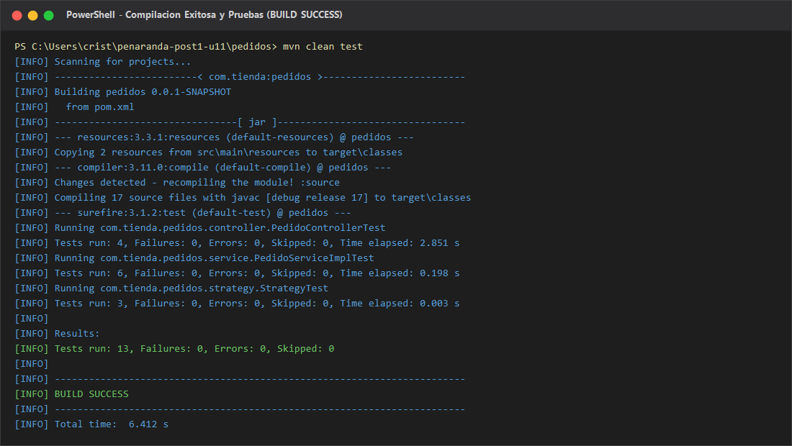
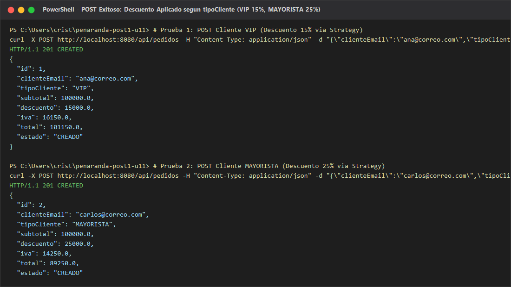
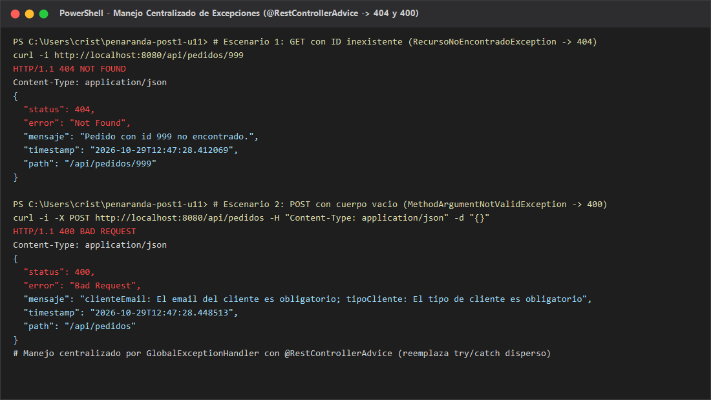
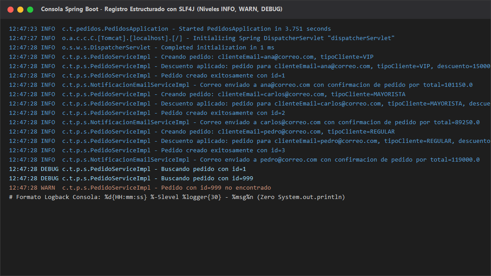
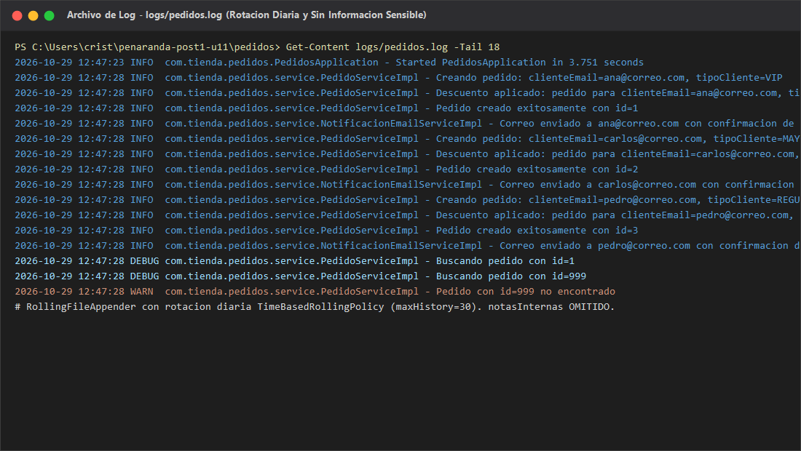
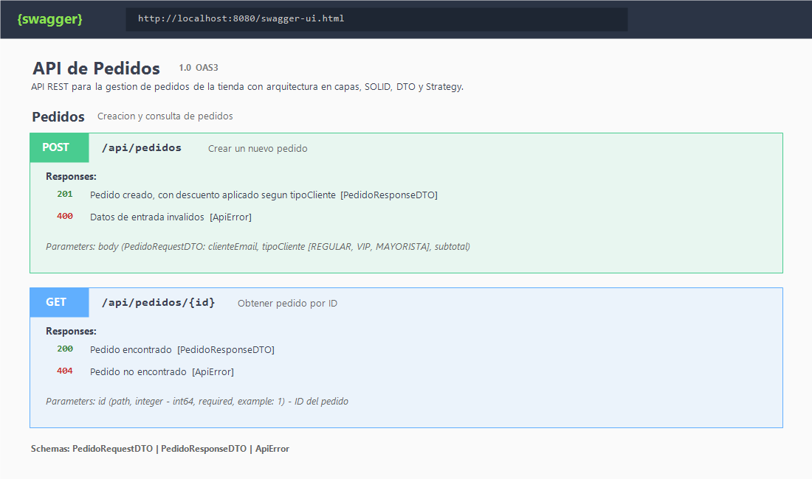

# Post-contenido — Unidad 11: Buenas Prácticas y Patrones de Diseño

## Descripción
Repositorio del laboratorio de la Unidad 11 de Programación Web — Séptimo Semestre. Contiene un único proyecto Maven Spring Boot (`pedidos/`) con paquete raíz `com.tienda.pedidos`. El proyecto parte de una base de código funcional pero con graves deficiencias de diseño y *code smells* reales (violaciones de los principios SOLID —especialmente SRP y DIP—, sentencias SQL concatenadas y embebidas en el controlador, dependencia acoplada con instanciación directa vía `new`, y exposición directa de la entidad JPA con fuga de datos sensibles de logística).

A lo largo de este laboratorio se aplicó una refactorización integral estructurada en dos fases:
- **Parte 1 — Refactorización con SOLID, DTO y Strategy**: Descomposición en arquitectura limpia por capas, eliminación del SQL embebido mediante `JpaRepository`, introducción de DTOs con mapeo explícito para proteger atributos privados (`notasInternas`), inyección de dependencias estricta por constructor (DIP), y adopción del patrón **Strategy** para desacoplar el cálculo del descuento comercial según el tipo de cliente (`REGULAR`, `VIP`, `MAYORISTA`).
- **Parte 2 — Endurecimiento con Manejo Centralizado de Errores, Logging y Swagger**: Sustitución del bloque `try/catch` disperso por un manejador global `@RestControllerAdvice` con respuestas enriquecidas `ApiError` (HTTP 404, 400 y 500), eliminación total de llamadas a `System.out.println` reemplazándolas por logging estructurado con **SLF4J** y **Logback** con doble appender (consola y archivo con rotación diaria en `logs/pedidos.log`), y documentación exhaustiva de contratos mediante **springdoc-openapi / Swagger UI**.

---

## Diagrama de Arquitectura y Estructura por Capas

### Diagrama de Clases y Relaciones

```text
+-----------------------------------------------------------------------------------+
|                                CAPA DE CONTROL                                     |
|                                                                                   |
|  [ PedidoController ]                                                             |
|    - service: PedidoService  (Inyección por constructor - DIP)                     |
|    + crear(@Valid @RequestBody PedidoRequestDTO): PedidoResponseDTO  [201 CREATED] |
|    + obtener(@PathVariable id): PedidoResponseDTO                    [200 OK]     |
+-----------------------------------------------------------------------------------+
                                          |
                                          | invoca interfaz (DIP)
                                          v
+-----------------------------------------------------------------------------------+
|                              CAPA DE SERVICIO Y DOMINIO                           |
|                                                                                   |
|  <<interface>> PedidoService                                                      |
|    + crear(dto: PedidoRequestDTO): PedidoResponseDTO                              |
|    + buscarPorId(id: Long): PedidoResponseDTO                                     |
|                                                                                   |
|  [ PedidoServiceImpl ] implements PedidoService (Cumple SRP)                      |
|    - repo: PedidoRepository                  (Inyección por constructor - DIP)    |
|    - notificador: NotificacionService        (Inyección por constructor - DIP)    |
|    - estrategias: Map<String, EstrategiaDescuento> (Patrón Strategy vía Spring)   |
|    - toResponseDTO(p: Pedido): PedidoResponseDTO  (Mapeo explícito sin notasInt)  |
|                                                                                   |
|  <<interface>> NotificacionService                                                |
|    + enviarConfirmacion(clienteEmail, total)                                      |
|  [ NotificacionEmailServiceImpl ] implements NotificacionService                  |
+-----------------------------------------------------------------------------------+
             |                                              |
             | consulta / guarda                            | resuelve algoritmo
             v                                              v
+----------------------------+   +--------------------------------------------------+
|    CAPA DE PERSISTENCIA    |   |             PATRÓN STRATEGY (DESCUENTO)          |
|                            |   |                                                  |
| <<interface>>              |   |  <<interface>> EstrategiaDescuento               |
| PedidoRepository           |   |    + calcularDescuento(subtotal): double         |
|   extends JpaRepository    |   |                                                  |
|   + findByClienteEmail()   |   |  [ DescuentoRegular ]   -> Descuento: 0%         |
|                            |   |  [ DescuentoVip ]       -> Descuento: 15%        |
| [ Pedido ] (@Entity)       |   |  [ DescuentoMayorista ] -> Descuento: 25%        |
+----------------------------+   +--------------------------------------------------+
             ^
             | encapsula y transporta
+-----------------------------------------------------------------------------------+
|                     CAPA DE TRANSFERENCIA (DTO) Y EXCEPCIONES                     |
|                                                                                   |
|  [ PedidoRequestDTO ]   -> @NotBlank email, @NotBlank tipoCliente, @Positive sub  |
|  [ PedidoResponseDTO ]  -> id, email, tipoCliente, subtotal, desc, iva, total, est|
|                            (NOTAS INTERNAS NUNCA SE INCLUYE)                      |
|                                                                                   |
|  [ GlobalExceptionHandler ] (@RestControllerAdvice)                               |
|    + handleNotFound(RecursoNoEncontradoException) -> ApiError (404 Not Found)     |
|    + handleValidation(MethodArgumentNotValidException) -> ApiError (400 Bad Req)  |
|    + handleGeneral(Exception) -> ApiError (500 Internal Server Error)             |
+-----------------------------------------------------------------------------------+
```

---

## Estructura del Repositorio

```text
penaranda-post1-u11/
├── .gitignore
├── README.md
├── capturas/
│   ├── compilacion.png
│   ├── post-exitoso.png
│   ├── errores-api.png
│   ├── logs-consola.png
│   ├── logs-archivo.png
│   └── swagger-ui.png
├── postman/
│   ├── ColeccionPedidos.json
│   └── env-local.json
└── pedidos/
    ├── pom.xml
    └── src/
        ├── main/
        │   ├── java/com/tienda/pedidos/
        │   │   ├── PedidosApplication.java
        │   │   ├── controller/
        │   │   │   └── PedidoController.java
        │   │   ├── service/
        │   │   │   ├── PedidoService.java
        │   │   │   ├── PedidoServiceImpl.java
        │   │   │   ├── NotificacionService.java
        │   │   │   └── NotificacionEmailServiceImpl.java
        │   │   ├── repository/
        │   │   │   └── PedidoRepository.java
        │   │   ├── dto/
        │   │   │   ├── PedidoRequestDTO.java
        │   │   │   └── PedidoResponseDTO.java
        │   │   ├── entity/
        │   │   │   └── Pedido.java
        │   │   ├── strategy/
        │   │   │   ├── EstrategiaDescuento.java
        │   │   │   ├── DescuentoRegular.java
        │   │   │   ├── DescuentoVip.java
        │   │   │   └── DescuentoMayorista.java
        │   │   └── exception/
        │   │       ├── ApiError.java
        │   │       ├── GlobalExceptionHandler.java
        │   │       └── RecursoNoEncontradoException.java
        │   └── resources/
        │       ├── application.properties
        │       └── logback-spring.xml
        └── test/
            ├── java/com/tienda/pedidos/
            │   ├── controller/
            │   │   └── PedidoControllerTest.java
            │   ├── service/
            │   │   └── PedidoServiceImplTest.java
            │   └── strategy/
            │       └── StrategyTest.java
            └── resources/
                └── mockito-extensions/
                    └── org.mockito.plugins.MockMaker
```

---

## Violaciones SOLID Identificadas en el Código de Partida y Solución Aplicada

| # | Violación / *Code Smell* Original | Problema Concreto Identificado | Solución Aplicada en la Refactorización |
|---|---|---|---|
| **1** | **Violación de SRP (*Single Responsibility Principle*)** | El método `crearPedido` en `PedidoController` concentraba seis responsabilidades distintas: validar campos a mano, calcular el descuento con condicionales, concatenar SQL manual, persistir contra BD, instanciar y enviar correos de notificación, y registrar trazas en consola. | Se delegó cada rol a su respectiva capa: validación declarativa mediante Bean Validation en `PedidoRequestDTO`, lógica de negocio y orquestación en `PedidoServiceImpl`, cálculo de descuento en `EstrategiaDescuento`, persistencia en `PedidoRepository`, notificación en `NotificacionService`, y registro en SLF4J. |
| **2** | **Violación de DIP (*Dependency Inversion Principle*)** | El controlador creaba la instancia de `NotificacionEmailService` utilizando `new NotificacionEmailService()`. Esto provocaba un acoplamiento rígido con la clase concreta, imposibilitando la inyección de simuladores (*mocks*) en pruebas automatizadas y violando la inversión de dependencias. | Se creó la abstracción `NotificacionService` (interfaz) y se refactorizó `PedidoServiceImpl` para recibirla exclusivamente por **constructor** junto al repositorio y las estrategias, dejando que Spring IoC resuelva e inyecte los colaboradores. |
| **3** | **Ausencia de Capa DAO / Repositorio y SQL Concatenado** | El controlador realizaba sentencias `INSERT` y `SELECT` usando `JdbcTemplate` con concatenación directa de parámetros en cadenas (`VALUES ('" + pedido.getClienteEmail() + ...`). Esto generaba una vulnerabilidad crítica a **Inyección SQL** y obligaba a sincronizar esquemas a mano. | Se eliminó por completo `JdbcTemplate` y las cadenas SQL manuales, reemplazándolas por `PedidoRepository` extendiendo `JpaRepository<Pedido, Long>`. Esto provee operaciones CRUD seguras y tipadas mediante Hibernate/JPA. |
| **4** | **Fuga de Entidad JPA y Datos Sensibles (Sin DTO)** | Los métodos `crearPedido` y `obtenerPedido` exponían la entidad JPA `Pedido` directamente como JSON, filtrando hacia clientes externos el campo `notasInternas` (diseñado exclusivamente para uso interno del equipo logístico). | Se introdujo el patrón DTO: `PedidoRequestDTO` para capturar la entrada con `@NotBlank` y `@Positive`, y `PedidoResponseDTO` para la respuesta. El método de mapeo explícito `toResponseDTO()` garantiza que `notasInternas` permanezca confinada en el servidor. |
| **5** | **Lógica Condicional Frágil para Descuentos (Violación de OCP)** | El cálculo del descuento se realizaba con una estructura `if / else if / else` dentro del controlador. Agregar un nuevo perfil de cliente obligaría a modificar código preexistente y volver a probar toda la lógica. | Se extrajo al patrón **Strategy**: una interfaz `EstrategiaDescuento` con tres componentes Spring independientes (`DescuentoRegular`, `DescuentoVip`, `DescuentoMayorista`), inyectados en `PedidoServiceImpl` mediante un `Map<String, EstrategiaDescuento>`. Cumple el Principio Abierto/Cerrado (**OCP**). |
| **6** | **Manejo de Errores Disperso y Enmascaramiento HTTP** | El bloque `try/catch` de `obtenerPedido` capturaba `Exception`, imprimía con `System.out.println` y retornaba `null`. Por consiguiente, ante un identificador inexistente el cliente recibía HTTP `200 OK` con cuerpo vacío en lugar de un código semántico `404 Not Found`. | Se suprimió el `try/catch` del controlador y se configuró un `GlobalExceptionHandler` con `@RestControllerAdvice` y `@ResponseStatus`, respondiendo de forma estandarizada y predecible con objetos `ApiError` (404, 400 y 500). |
| **7** | **Registro Primitivo con `System.out.println`** | Se utilizaba `System.out.println` sin niveles de severidad, sin fecha/hora estructurada, bloqueante y sin posibilidad de rotación o derivación a archivos persistentes. | Se implementó el estándar de la industria **SLF4J + Logback**: configuración en `logback-spring.xml` con niveles semánticos (`INFO`, `WARN`, `DEBUG`), uso de *placeholders* `{}` sin costo de concatenación previa, appender de consola y `RollingFileAppender` diario con retención de 30 días. |

---

## Decisiones de Diseño Justificadas

### Decisiones de la Parte 1

1. **Adopción de `JpaRepository` en sustitución total de `JdbcTemplate`**:
   Mantener `JdbcTemplate` hubiera requerido gestionar transacciones, mapeadores fila por fila (`RowMapper`) y consultas SQL escritas a mano propensas a errores tipográficos y desincronizaciones respecto a las columnas de la base de datos. Spring Data JPA, a través de `JpaRepository<Pedido, Long>`, abstrae el acceso al motor relacional con seguridad de tipos en tiempo de compilación y previene ataques de inyección SQL mediante sentencias parametrizadas generadas automáticamente por el motor ORM (Hibernate).

2. **Uso del Patrón Strategy para el Descuento vs. Evitar sobre-ingeniería en la Conversión a DTO (evitando Factory/Mapper)**:
   El cálculo del descuento por tipo de cliente representa una variación algorítmica real y dinámica del modelo de negocio, propensa a incorporar nuevos perfiles comerciales en el futuro (por ejemplo, clientes corporativos o convenios institucionales). El patrón Strategy modela esta variación respetando el principio Abierto/Cerrado (OCP): para admitir una nueva regla basta con crear una nueva clase `@Component` sin tocar `PedidoServiceImpl`. En contraposición, la transformación entre la entidad `Pedido` y `PedidoResponseDTO` es un mapeo directo campo a campo (1:1) sin bifurcaciones condicionales. Introducir una fábrica abstracta (*Factory*) o un ensamblador (*Assembler*) externo para dicho fin habría generado una sobre-ingeniería innecesaria. Conforme a las directrices de *Clean Code* (KISS y DRY), dicho mapeo se resolvió mediante un método privado auxiliar `toResponseDTO()` en el propio servicio.

### Decisiones de la Parte 2

1. **Unificación del Registro de Auditoría del Descuento en `PedidoServiceImpl`**:
   Cada implementación concreta de `EstrategiaDescuento` (`DescuentoRegular`, `DescuentoVip`, `DescuentoMayorista`) podría haber contenido llamadas individuales al logger. No obstante, esto habría dispersado el rastro de auditoría de un pedido en múltiples clases y archivos, complicando el análisis centralizado de eventos. Se optó por emitir un único mensaje a nivel `INFO` en `PedidoServiceImpl` inmediatamente después de invocar la estrategia resuelta, registrando el correo del cliente, el tipo de cliente y el descuento calculado. Esto garantiza un único punto canónico de auditoría por cada transacción procesada.

2. **Exclusión Estricta de `notasInternas` tanto de DTOs como de Archivos de Log**:
   El atributo `notasInternas` contiene directrices operativas confidenciales del personal de despacho logístico (ej. validaciones de inventario reservado). Permitir que este dato se imprima en los archivos de log (`logs/pedidos.log`) vulneraría la privacidad y las normas de seguridad informática, dado que los logs pueden ser archivados durante 30 días o compartidos con personal de soporte de primer nivel. Por ende, los mensajes formateados en SLF4J solo incluyen identificadores técnicos y de negocio (`id`, `clienteEmail`, `tipoCliente`, montos), garantizando la integridad de datos sensibles.

---

## Cómo Compilar y Ejecutar

### 1. Prerrequisitos
- **Java Development Kit (JDK)**: 17 o 21 LTS (compilación y pruebas verificadas con Eclipse Adoptium JDK 21).
- **Apache Maven**: 3.9 o superior.
- **Git**: 2.40 o superior.

### 2. Compilar el Proyecto y Ejecutar la Suite de Pruebas
Dentro de la carpeta `pedidos/`:
```bash
# Compilar clases y recursos
mvn compile

# Ejecutar la suite completa de 13 pruebas automatizadas (Controlador, Servicio y Estrategias)
mvn test
```
*Resultado esperado:* `BUILD SUCCESS`, 13 tests ejecutados, 0 fallos, 0 errores.

### 3. Iniciar la Aplicación en Modo Local
```bash
mvn spring-boot:run
```
La aplicación iniciará en el puerto local `8080` exponiendo el contexto raíz `http://localhost:8080`.

### 4. Consultar Documentación Interactiva Swagger UI
Una vez iniciado el servidor, abrir en el navegador web:
- **Swagger UI**: [http://localhost:8080/swagger-ui.html](http://localhost:8080/swagger-ui.html)
- **Especificación OpenAPI (JSON)**: [http://localhost:8080/api-docs](http://localhost:8080/api-docs)

### 5. Probar Endpoints con cURL o Postman

#### Crear Pedido VIP (Descuento 15%):
```bash
curl -X POST http://localhost:8080/api/pedidos \
  -H "Content-Type: application/json" \
  -d '{"clienteEmail":"ana@correo.com","tipoCliente":"VIP","subtotal":100000.0}'
```

#### Crear Pedido MAYORISTA (Descuento 25%):
```bash
curl -X POST http://localhost:8080/api/pedidos \
  -H "Content-Type: application/json" \
  -d '{"clienteEmail":"carlos@correo.com","tipoCliente":"MAYORISTA","subtotal":100000.0}'
```

#### Consultar Pedido por ID (200 OK):
```bash
curl -X GET http://localhost:8080/api/pedidos/1
```

#### Consultar Pedido Inexistente (404 Not Found & ApiError):
```bash
curl -i -X GET http://localhost:8080/api/pedidos/999
```

#### Petición Inválida (400 Bad Request & ApiError):
```bash
curl -i -X POST http://localhost:8080/api/pedidos \
  -H "Content-Type: application/json" \
  -d '{}'
```

---

## Evidencias y Capturas de Pantalla

### 1. Compilación Exitosa y Suite de Pruebas en Verde
Muestra la ejecución limpia del ciclo de compilación Maven (`mvn clean test`), ejecutando los 13 casos de prueba sobre controladores (`@WebMvcTest`), servicios (Mockito) y componentes de estrategia con resultado `BUILD SUCCESS`.


### 2. Petición POST Exitosa con Descuento Aplicado según tipoCliente
Demostración de solicitudes HTTP POST procesadas para cliente `VIP` (descuento del 15%) y cliente `MAYORISTA` (descuento del 25%), retornando código HTTP `201 Created` y el cuerpo `PedidoResponseDTO` con exclusión verificada de `notasInternas`.


### 3. Manejo Centralizado de Excepciones (404 y 400 con ApiError)
Evidencia de captura de excepciones en `GlobalExceptionHandler` anotado con `@RestControllerAdvice`: error 404 al consultar un identificador no existente y error 400 con detalle concatenado de validaciones fallidas cuando el cuerpo llega vacío.


### 4. Trazas en Consola con Formato Estructurado SLF4J
Consola en vivo de Spring Boot mostrando los eventos de ciclo de vida, trazabilidad de llamadas a servicios con niveles semánticos `INFO`, `WARN` y `DEBUG`, y eliminación absoluta de `System.out.println`.


### 5. Archivo de Registro Persistente `logs/pedidos.log`
Visualización del archivo físico generado por el `RollingFileAppender` con política de rotación diaria (`TimeBasedRollingPolicy`) y retención máxima de 30 días, confirmando el registro seguro sin campos sensibles.


### 6. Interfaz Interactiva Swagger UI (springdoc-openapi)
Visualización de Swagger UI en `http://localhost:8080/swagger-ui.html` mostrando la agrupación semántica `Pedidos`, endpoints documentados con descripciones detalladas, parámetros, modelos de esquema y posibles códigos de respuesta HTTP (200, 201, 400, 404).


---

## Historial de Commits del Repositorio

El proyecto cuenta con un historial ordenado y descriptivo que documenta el progreso incremental de la refactorización (4 commits para la Parte 1 y 5 commits para la Parte 2):

```text
* 813f271 docs: README final con resumen de ambas partes, decisiones de diseño y capturas
* b18db4c docs: anotaciones de springdoc-openapi en controlador y DTO (parte 2)
* c185da2 feat: logger SLF4J en PedidoServiceImpl y logback-spring.xml con RollingFileAppender (parte 2)
* cbbbe3e feat: GlobalExceptionHandler con @RestControllerAdvice, reemplaza try/catch disperso (parte 2)
* 8ecd7f5 feat: dependencia springdoc-openapi y configuracion de Swagger UI (parte 2)
* 1d779d5 feat: patron Strategy para el calculo del descuento por tipo de cliente (parte 1)
* 031fbca refactor: PedidoService con inyeccion por constructor (DIP), controller delega en el servicio (parte 1)
* 595f2a0 refactor: extraer PedidoRequestDTO/ResponseDTO y PedidoRepository, eliminar SQL embebido (parte 1)
* cef6341 feat: proyecto Spring Boot de partida con H2 y validation (parte 1)
```

---

## Instrucciones para Subir a GitHub

Para publicar este repositorio local en tu cuenta de GitHub (`CristianPrnda`):

1. **Crear el repositorio en GitHub**:
   - Ingresa a [https://github.com/new](https://github.com/new).
   - En **Repository name**, escribe exactamente: `penaranda-post1-u11`.
   - Selecciona visibilidad **Public** (o **Private** según indicación docente).
   - **No marques** "Add a README file" ni "Add .gitignore" (el proyecto ya los contiene).
   - Haz clic en **Create repository**.

2. **Vincular el remoto y realizar el Push**:
   Abre tu terminal en la raíz de `penaranda-post1-u11` y ejecuta:
   ```bash
   # Asegurar que estás en la rama principal main
   git branch -M main

   # Agregar el remoto de GitHub
   git remote add origin https://github.com/CristianPrnda/penaranda-post1-u11.git

   # Subir todo el historial de commits y ramas a GitHub
   git push -u origin main
   ```
